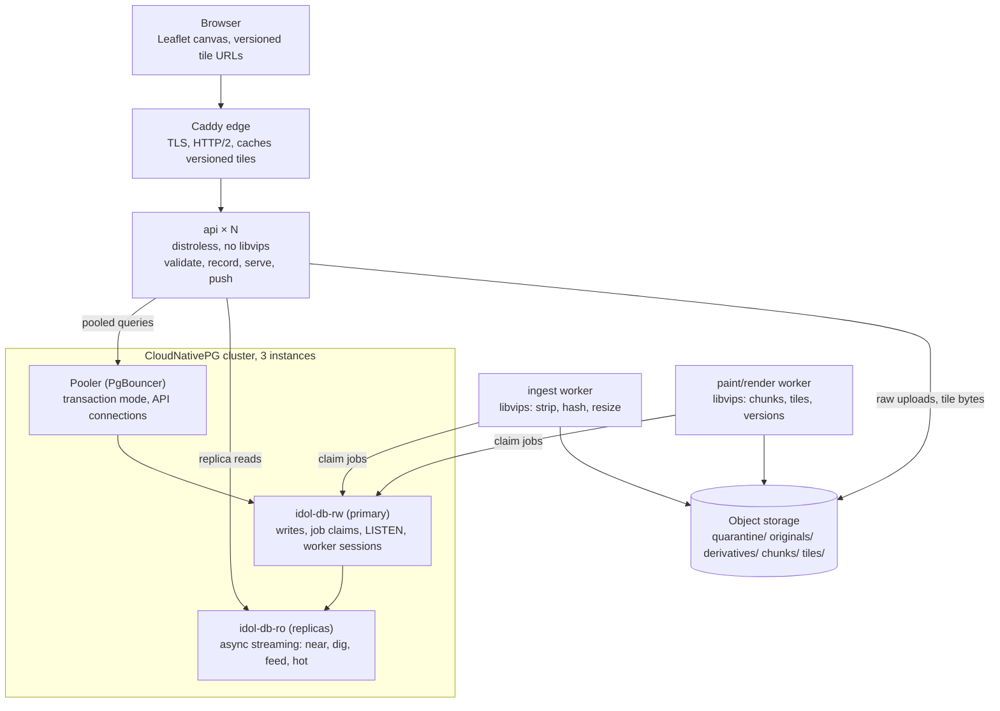
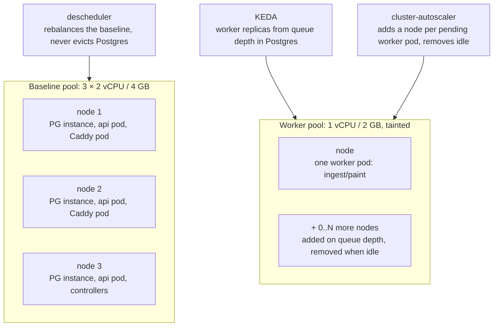
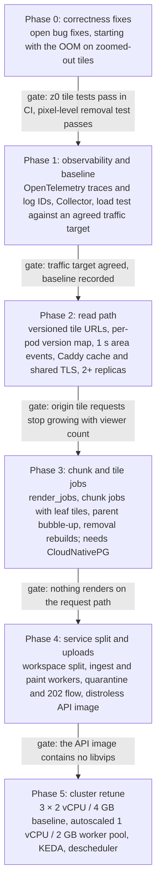

# Infinite idol canvas — scaling and render architecture

Design doc, 2026-10-14. Rollout tracked in
[#163](https://github.com/vreid/idol-appreciation.club/issues/163).

## Summary

Move chunk painting and tile generation into a version-driven background
pipeline run by dedicated workers, so the API only validates, records and serves
cached, versioned bytes, and never runs libvips.

- **Why:** one placement costs 0.9–9 s of single-threaded image work inside the
  API pod today, and every viewer re-downloads every visible tile, uncached, on
  every change. Both multiply under r/place-style traffic.
- **What changes:**
  - Chunks get explicit versions. Workers claim them from a Postgres job queue,
    paint new placements in batches and cut the chunk's tiles in the same pass.
    Parent tiles bubble up; zoomed-out tiles refresh on a timer.
  - Tile URLs carry the version and are cached indefinitely by browsers and
    Caddy. Events go out once per second per area of the canvas.
  - Uploads are processed by an ingest worker. The API ships as a distroless
    image.
  - OpenTelemetry traces and logs follow a placement from request to queue to
    worker.
- **Order:** Phase 0 fixes seven open correctness bugs, then the read path, then
  chunk and tile jobs, then the service split and the new upload flow.

## Context and measurements

Reads break first: every placement makes every viewer of that area re-download
its visible tiles, uncached, while writes are capped by one libvips lock per
pod.

How it works today:

- **Placement** (`place.rs`): decode, strip and resize the upload, then download
  every chunk the image touches, paint it on, and upload the chunk again, all
  inside the request and under one process-wide libvips lock.
- **Tiles** (`tiles.rs`): rendered on request. Zoom 18–20 tiles are cut from the
  chunk; lower zooms are stitched from four children. Stale tiles are served
  while a background worker re-renders them.
- **Live updates:** one SSE message per placement goes to every client. Clients
  refetch affected tiles at most every 500 ms with `?r=Date.now()`, so no cache
  can help. Caddy is a plain proxy.
- **Demand:** the 1 s cooldown for empty space allows up to about 1 placement
  per second per active user.

Measured image work per placement (release build of `c95f128` on a 6-core dev
box; one placement at a time, as under the libvips lock):

| Upload → placed at        | Strip + resize (ms) | Chunks painted | Painting (ms) | Total (ms) |
| ------------------------- | ------------------- | -------------- | ------------- | ---------- |
| 4096² → 4096, rotated 30° | 1,949               | 36             | 7,111         | 9,060      |
| 4096² → 4096              | 1,939               | 25             | 4,505         | 6,444      |
| 4096² → 1024              | 779                 | 4              | 712           | 1,491      |
| 1024² → 1024              | 167                 | 4              | 742           | 909        |
| 1024² → 256               | 54                  | 4              | 643           | 697        |

Other costs that shape the design:

- **Rebuilding a chunk from its images** costs about 80 ms per image: 200 images
  took 15.8 s. The production pile averages an estimated ~500 images per chunk,
  so rebuilds are for removals and repair only.
- **Cutting all 21 zoom 18–20 tiles** from a chunk already in memory takes 268
  ms and about as much storage as the chunk (348 KB vs 374 KB).
- **Repeated lossy re-encoding** drifts untouched chunk pixels to 39 dB PSNR
  (max channel error 44/255) after about 50 rewrites, then stabilises.
- **Read load** while an area is active is roughly 2 × viewers × visible tiles
  requests per second, e.g. 5,000 viewers × 20 tiles ≈ 200,000 requests/s, each
  running a database query before any cache check.

## Phase 0: correctness fixes

Seven verified bugs come first.
[#150](https://github.com/vreid/idol-appreciation.club/issues/150) can take down
production pods today, and
[#153](https://github.com/vreid/idol-appreciation.club/issues/153) and
[#159](https://github.com/vreid/idol-appreciation.club/issues/159) mean removals
don't reliably take images off the canvas.

| Issue                                                              | Problem                                                           | Effect today                                                                                                |
| ------------------------------------------------------------------ | ----------------------------------------------------------------- | ----------------------------------------------------------------------------------------------------------- |
| [#150](https://github.com/vreid/idol-appreciation.club/issues/150) | Tile requests walk every tile under them (4× cost per zoom level) | Zoom 0–5 requests run the pod out of memory; z7 costs 1.7 s CPU per request                                 |
| [#159](https://github.com/vreid/idol-appreciation.club/issues/159) | Removal repaints onto the current chunk instead of blank          | Removed images stay in the pixels and reappear when the tile next changes                                   |
| [#153](https://github.com/vreid/idol-appreciation.club/issues/153) | Removal doesn't advance any version                               | Cached tiles and dig stacks keep showing removed images                                                     |
| [#152](https://github.com/vreid/idol-appreciation.club/issues/152) | Tile freshness uses the unrotated rect                            | Rotated images are cut off at chunk edges (blank paper)                                                     |
| [#151](https://github.com/vreid/idol-appreciation.club/issues/151) | Stored-tile lookup queries the wrong range                        | Every re-render redoes the whole subtree from chunks                                                        |
| [#154](https://github.com/vreid/idol-appreciation.club/issues/154) | Import skips the cross-replica chunk locks                        | An import and a placement can overwrite each other's pixels                                                 |
| [#155](https://github.com/vreid/idol-appreciation.club/issues/155) | Zoom ≤ 4 cache keyed by version, never evicted                    | Memory grows without bound once [#150](https://github.com/vreid/idol-appreciation.club/issues/150) is fixed |

Five smaller pool and performance items are tracked as a comment on
[#120](https://github.com/vreid/idol-appreciation.club/issues/120).
[#150](https://github.com/vreid/idol-appreciation.club/issues/150),
[#151](https://github.com/vreid/idol-appreciation.club/issues/151) and
[#152](https://github.com/vreid/idol-appreciation.club/issues/152) touch the
same snapshot code in `tiles.rs` and should land as one PR.

## Target architecture



Placements and removals become rows and jobs in Postgres, workers turn them into
pixels and versions, and the API only reads versions and bytes.

**Code and images**

- One Cargo workspace: `core` (world math, queries, models), `api`, `worker`.
  Only `worker` depends on libvips, so the API binary can't link it by accident.
- **API image:** `gcr.io/distroless/cc-debian13:nonroot`. It must be the Debian
  13 variant: the builder is `rust:trixie` (glibc 2.41), and a Debian 12 base
  (glibc 2.36) can't run its binaries. sqlx and object_store use rustls, so no
  OpenSSL is needed. Probes stay `httpGet`, since there's no shell.
- **Worker image:** stays on `debian:trixie-slim` with the pinned `libvips42`.
  One binary with a role flag (`ingest`, `paint`, `render`), split into separate
  Deployments once metrics justify it.

**Database: CloudNativePG**
([#160](https://github.com/vreid/idol-appreciation.club/issues/160) and
[#161](https://github.com/vreid/idol-appreciation.club/issues/161))

- **API traffic goes through a CloudNativePG `Pooler`** (PgBouncer, transaction
  mode) to `idol-db-rw`. Set `max_prepared_statements` so sqlx's prepared
  statements work in transaction mode.
- **Session features connect to `idol-db-rw` directly:** the LISTEN connection
  and the workers. Today's session-level chunk advisory locks (`chunks.rs`) also
  need a direct connection; they go away once chunk ownership comes from the job
  claim.
- **Browsing reads can use `idol-db-ro`:** near, dig, feed and hot. Cooldown
  checks and job claims stay on the primary, because asynchronous replicas lag.
- **Connection budget:** the primary's `max_connections` of 100 must cover the
  pooler's server connections, one listener per API pod, the workers,
  replication and reserved slots.
- **Failover** drops the LISTEN connection. `events.rs` reconnects after 2 s,
  and clients re-fetch current versions on reconnect, so missed notifications
  are harmless.
- **Job tables** must delete finished rows. Today's `tile_render_jobs` keeps
  `done` rows forever, and every row change is WAL that the replicas replay.
- **Backups:**
  [#161](https://github.com/vreid/idol-appreciation.club/issues/161)'s Cluster
  has no backup configuration, and its storage class reclaims volumes on delete.
  Add WAL archiving and base backups to object storage (CloudNativePG's Barman
  Cloud plugin) before the cutover.

## Chunk and tile pipeline

A chunk job brings one chunk up to date and cuts its 21 tiles in the same pass.
Parent tiles follow through merged jobs, so tile requests never render anything.

This builds on the `chunk_seqs` table from
[#158](https://github.com/vreid/idol-appreciation.club/issues/158): one content
version per chunk, advanced by every placement and by every removal. The
pipeline adds what has been _painted_ next to what is _wanted_. A chunk is
exactly a zoom 18 tile, so one job table keyed by `(z, x, y)` covers both kinds
of job.

```sql
ALTER TABLE chunk_seqs
  ADD COLUMN painted_seq   bigint  NOT NULL DEFAULT 0,      -- version the stored raster and tiles show
  ADD COLUMN needs_rebuild boolean NOT NULL DEFAULT false;  -- set by removals

CREATE TABLE render_jobs (
  z smallint NOT NULL, x integer NOT NULL, y integer NOT NULL, -- z = 18: chunk job; z < 18: parent job
  state      text        NOT NULL DEFAULT 'pending',          -- pending | running | failed
  rerun      boolean     NOT NULL DEFAULT false,              -- changed while running
  not_before timestamptz NOT NULL DEFAULT now(),              -- per-zoom delay
  claimed_at timestamptz,
  attempts   smallint    NOT NULL DEFAULT 0,
  PRIMARY KEY (z, x, y)
);
```

**Chunk job** (z = 18):

1. Claim the row with `FOR UPDATE SKIP LOCKED`, so exactly one worker owns the
   chunk. This replaces the session advisory locks.
2. If `needs_rebuild` is set, repaint from blank: every live placement, in
   sequence order (this is
   [#159](https://github.com/vreid/idol-appreciation.club/issues/159)'s fix).
   Otherwise paint only the placements newer than `painted_seq` onto the current
   raster, using the import engine's `composite_group`.
3. Cut the zoom 18, 19 and 20 tiles from the raster already in memory (268 ms
   for all 21).
4. Write the chunk and tiles, then set `painted_seq` with a guard
   (`WHERE painted_seq < $v`), so a slower job can never move a version
   backwards.
5. Mark the zoom 17 parent dirty.

**Parent job** (z < 18): rebuild from the four children's current bytes. Its
version is the highest child version, which only grows. Then mark its own parent
dirty.

**Merging rules:**

- **One row per tile:** marking it dirty is an upsert, so a burst of changes
  becomes one job.
- **A job that's running is never aborted.** A change that arrives meanwhile
  sets `rerun`, and the job puts itself back in the queue when it finishes.
  Aborting would starve busy chunks.
- **Zoom-dependent delay:** `not_before` holds parents back: z ≤ 10 at most
  every 10–30 s, z 11–17 after a short quiet window. Workers claim deeper zooms
  first, so children finish before their parents.
- **Clean-up:** finished rows are deleted. After 5 attempts a job is marked
  `failed` instead of retrying forever, so a crash-inducing image can't loop.

**Ordering:** paint order must equal sequence order, but sequence numbers are
assigned inside transactions that can commit out of order. Placement rows are
inserted in batches by the ingest worker while it holds a single sequencer row
lock until commit, so commit order equals sequence order. As a safety net, a
chunk job that finds a committed sequence number below `painted_seq` sets
`needs_rebuild`.

**Removal** sets `removed_at`, advances the chunk's version and sets
`needs_rebuild`, then returns. The rebuild costs about 80 ms per remaining
image: roughly 40 s for a chunk in the production pile, which is why it has to
run in the background.

## Read path

Tile URLs carry their version and are cached forever, so each tile version is
served about once per cache rather than once per viewer.

- **Versioned URLs:** `/api/tiles/{z}/{x}/{y}.webp?v={version}` replaces the
  client's `?r=Date.now()`. Clients learn versions from events and from a
  viewport snapshot (`GET /api/versions?bbox=…&z=…`).
- **No database work per tile request:** each API pod keeps the current versions
  in memory. They're loaded from `idol-db-ro` on a miss and kept fresh by the
  workers' notifications. Tile objects are overwritten in place in storage; only
  the URL is versioned, so there's nothing to clean up.

| Request                                                        | Response                                                  |
| -------------------------------------------------------------- | --------------------------------------------------------- |
| `v` is current                                                 | 200, `Cache-Control: public, max-age=31536000, immutable` |
| `v` is older                                                   | 200 with the current bytes, `max-age=60`                  |
| `v` is newer (the event arrived before this pod's map updated) | 200 with the current bytes, `no-store`                    |
| no `v` (old clients)                                           | 200, `max-age=1`, as today                                |

- **Caddy cache:** build Caddy with `xcaddy` and the `cache-handler` module, and
  cache only tile responses marked `immutable`. The cache is in memory, so a
  restart empties it.
- **Single edge pod:** Caddy is pinned to one replica because its TLS volume can
  only be mounted once. Every request and every live stream passes through that
  pod. Cluster layout (below) moves certificates to shared storage, so the edge
  can run several replicas.
- **Events once per second per area:** the API batches worker notifications into
  1 s ticks. Each client receives only the tile versions that changed inside the
  area it subscribed to (its viewport, sent on connect and again after large
  pans).
- **Reconnects:** on (re)connect the client fetches the snapshot for its
  viewport. Missed events (failover, lag, a full buffer) therefore can't leave
  tiles stale, and event IDs aren't needed.
- **SSE vs WebSockets:** keep SSE. It runs over HTTP/2 to browsers, reconnects
  by itself, and Caddy already proxies it. Switch to WebSockets when presence or
  live cursors need client-to-server messages on the same connection.
- **Sizing:** every viewer holds one stream through Caddy to an API pod. At
  r/place scale that count, not request rate, sizes Caddy and the API pods (file
  descriptors, memory per stream).

## Upload flow

Accept 4096×4096 uploads and keep the original, but cap the size images are
placed at and do all pixel work in the ingest worker. A 4096 original adds about
0.6 s of worker time; _placing_ it at 4096 costs 6–9 s.

1. **API checks:** stream the multipart under the byte cap and parse the image
   header in pure Rust: dimensions, EXIF orientation, first animation frame.
   Decompression bombs, out-of-bounds placements and cooldowns are rejected
   before anything is stored.
2. **API accepts:** claim the cooldown, store the raw upload as
   `quarantine/{upload id}` (private, because it still contains EXIF/GPS),
   insert an upload row and an ingest job, and return `202` with the upload id.
   The client shows its own preview immediately.
3. **Ingest worker processes:** decode, strip, re-save and hash into
   `originals/{sha}`, then build the derivative at the placed size into
   `derivatives/{sha}.webp`. If libvips disagrees with the API's header read,
   the job fails and the cooldown is refunded. Then delete the quarantine
   object.
4. **Ingest worker records:** insert the placement rows in a batch under the
   sequencer lock, advance the chunk versions and queue the chunk jobs.
5. **Client is told:** an event reports that the placement is live, or why it
   failed.

The admin import uses the same worker. A lifecycle rule on `quarantine/` (e.g.
delete after 24 h) backs up step 3's cleanup.

**Decisions needed:**

- **Byte cap:** 10 MiB fits a 4096² JPEG (3.9 MB measured), but a 4096² photo
  saved as PNG is likely several times that (estimate, not measured). Raise the
  cap, or ask clients for JPEG, WebP or AVIF.
- **Placed size:** cap the long edge (e.g. 2048), or scale the cooldown with the
  number of chunks touched: a 1024 image touches 4 chunks, a 4096 image 25–36.

## Cluster layout



The baseline is three 2 vCPU / 4 GB nodes running Postgres, the API and Caddy.
All libvips work moves to a tainted pool of 1 vCPU / 2 GB nodes that grows and
shrinks with the job queue.

- **Shrink nodes only after the split:** today's backend needs a 2 GiB memory
  limit for libvips bursts (it was OOM-killed at 1.5 GiB in the 2026-10-13
  soak). That doesn't fit beside a Postgres instance on a 4 GB node. Move to 2
  vCPU / 4 GB nodes in the same phase that moves libvips to the worker pool.
- **Size Postgres for 4 GB nodes:**
  [#161](https://github.com/vreid/idol-appreciation.club/issues/161) gives each
  instance a 1.5 GiB request but a 3 GiB limit on nodes with roughly 3.3 GB
  allocatable (estimate). Set request equal to limit (about 1.5 GiB) so a busy
  instance can't starve the API on its node.
- **Coordinate with
  [#160](https://github.com/vreid/idol-appreciation.club/issues/160)**, which
  raises today's 4 vCPU / 8 GB group to three nodes. This layout replaces that
  group with two: a baseline group of three, and a second
  `upcloud_kubernetes_node_group` for workers.
- **Worker pool:** nodes carry a `dedicated=worker:NoSchedule` taint and a pool
  label; only worker pods tolerate it. One worker pod per node (about 800m CPU
  and 1.2 GiB requested) matches libvips' one-pipeline-per-process limit. Its
  memory has to be measured in the load test.
- **Scaling chain:** KEDA's PostgreSQL scaler sets worker replicas from the
  number of pending jobs. Pods that don't fit stay pending, and the UpCloud
  cluster-autoscaler (already in the chart, switched off) adds a worker node.
  Idle nodes are removed after the scale-down delay. Whether UpCloud allows a
  node group of 0 is open; otherwise the floor is 1.
- **Shutting down workers:** on SIGTERM a worker stops claiming and finishes its
  current job within a ~120 s grace period (rebuilds can take ~40 s). If it's
  killed anyway, the claim expires and another worker retakes the job.
- **Caddy, horizontally:** drop the single-mount TLS volume and store
  certificates and ACME state in object storage with a CertMagic storage module.
  That goes in the same custom `xcaddy` build as the cache module, and CertMagic
  coordinates certificate renewal across replicas through the shared storage.
  Run two or more replicas with a PodDisruptionBudget and topology spread. Each
  replica keeps its own tile cache. The fallback is cert-manager writing a
  Secret that every replica mounts, plus a restart on renewal;
  `deploy/30-issuer.yaml` already has a ClusterIssuer, but it solves challenges
  through an nginx ingress that no longer exists.
- **Descheduler:** run every 10–30 minutes with `RemoveDuplicates`,
  `RemovePodsViolatingTopologySpreadConstraint`, `RemovePodsViolatingNodeTaints`
  and `LowNodeUtilization`, scoped to the baseline pool. Exclude Postgres
  instances (label `cnpg.io/cluster`) and pods with volumes. Leave the worker
  pool to the cluster-autoscaler, since evicting a running job wastes it.

## Observability

Add OpenTelemetry tracing with trace-correlated logs to the API and workers,
export it over OTLP to a Collector, and let that Collector scrape the existing
metrics until they move to the OpenTelemetry API.

**Today:**

- **Logs:** JSON on stdout, with no request or trace ID. The only span is
  `TraceLayer`'s default, which is DEBUG-level and therefore filtered out at
  `RUST_LOG=info`.
- **Metrics:** a hand-rolled Prometheus endpoint (`/api/metrics`, `metrics.rs`)
  built from global atomics. It works, but the globals make tests interfere with
  each other: import tests already have to run one at a time.
- **Traces:** none. Nothing ties a slow request to its database, S3 or libvips
  time; the [#120](https://github.com/vreid/idol-appreciation.club/issues/120)
  investigation had to rely on Postgres slow-query logs and `EXPLAIN`.

**Setup:**

- **Crates:** `opentelemetry`, `opentelemetry_sdk` and `opentelemetry-otlp` 0.33
  (HTTP/protobuf, its default blocking client) with `tracing-opentelemetry`
  0.34, the current versions on 2026-10-14.
- **One `telemetry` module, initialised by each binary:** the existing JSON log
  layer, plus the OpenTelemetry layer whenever an OTLP endpoint is configured,
  the W3C `traceparent` propagator, and a flush on SIGTERM.
- **Standard environment variables only:** `OTEL_EXPORTER_OTLP_ENDPOINT`,
  `OTEL_SERVICE_NAME` (`api`, `worker-ingest`, `worker-paint`),
  `OTEL_RESOURCE_ATTRIBUTES` (version, environment, plus pod and node names from
  the downward API) and `OTEL_SDK_DISABLED`. Unset means logs only, as today.
- **Sampling:** start at `parentbased_traceidratio` with 5%, because tile
  requests are the bulk of traffic. Add tail sampling in a single gateway
  Collector later, to keep every error and every trace over 1 s.
- **Request IDs:** `tower-http`'s request-ID middleware adds `x-request-id` to
  every response. Each JSON log line then carries `request_id`, `trace_id` and
  `span_id`, so logs and traces join on the ID.

| Span                                                                 | Created in                                                         | Key attributes                                                              |
| -------------------------------------------------------------------- | ------------------------------------------------------------------ | --------------------------------------------------------------------------- |
| HTTP server, named by route template (`GET /api/tiles/{z}/{x}/{*y}`) | the router's `TraceLayer`, parent taken from `traceparent`         | `http.route`, `http.response.status_code`, `request_id`                     |
| `postgresql <family>`                                                | `dbq::timed`, which already wraps every query: one place to change | `db.system.name`, `db.query.summary`, which endpoint (pooler, `-rw`, `-ro`) |
| `S3.GetObject` / `S3.PutObject`                                      | `store.rs`                                                         | `aws.s3.key`, object size                                                   |
| `vips.lock_wait`, then `vips.<operation>`                            | `img.rs`, at each `VIPS.lock()`                                    | operation, pixel count; lock wait is the serialization signal               |
| `job <kind>` (one root span per claimed job)                         | worker claim loop                                                  | job key, attempt, span link to the request that queued it                   |
| `events.tick`                                                        | the API's 1 s event batcher                                        | changes in the tick, subscribers reached                                    |

Three rules keep the traces useful:

- **Carry context into blocking threads:** libvips work runs in
  `spawn_blocking`, so one helper must take the current span into the closure.
  Otherwise every libvips span becomes a disconnected trace.
- **No orphan spans:** database and S3 spans are created only under an existing
  span. The workers' once-a-second queue polls must not become traces of their
  own.
- **Context through the queue:** job rows store the enqueuing request's
  `traceparent` in a new column. One placement's trace then links upload,
  ingest, painting and tiles across services.

**Metrics:**

1. **First:** the Collector scrapes `/api/metrics` and CloudNativePG's
   per-instance metrics (port 9187) with its Prometheus receiver, with no
   application change.
2. **Later:** move `metrics.rs` onto the OpenTelemetry metrics API, created per
   app instance rather than as globals, keeping its function names. Add job
   queue depth and age per kind, job duration, libvips lock wait, rebuild
   duration, event lag and SSE connections.

**Collector:** the OpenTelemetry Collector (contrib) as a DaemonSet that
tolerates the worker taint, so it can also read pod logs (`filelog`). It
receives OTLP and exports to the chosen backend, which is still an open
question. Budget about 100–200 MiB per node; the 2 GB worker nodes have to fit
it next to the worker.

## Phased rollout



Each phase ends at a gate the load test or CI can check, and the cluster only
shrinks once the API no longer needs libvips' memory headroom. The phases, their
task lists and their dependencies on
[#158](https://github.com/vreid/idol-appreciation.club/issues/158),
[#160](https://github.com/vreid/idol-appreciation.club/issues/160) and
[#161](https://github.com/vreid/idol-appreciation.club/issues/161) are tracked
in [#163](https://github.com/vreid/idol-appreciation.club/issues/163).

## Open questions

- [ ] **Traffic target:** how many concurrent viewers and placements per second
      should the load test prove?
- [ ] **Cooldown policy:** keep 1 s for empty space, or scale the cooldown with
      footprint?
- [ ] **Size caps:** the byte cap for 4096² PNGs, and the maximum placed size
      (see Upload flow).
- [ ] **Full-resolution originals:** does a feature need them (download, "view
      original")? If not, the size cap can apply to storage too.
- [ ] **Chunk encoding:** stay with lossy WebP Q90 (drift stops at 39 dB), go
      lossless (larger objects on every download and upload), or rebuild busy
      chunks periodically?
- [ ] **Edge:** vet a CertMagic S3 storage module (with locking) for shared
      certificates, or fall back to cert-manager.
- [ ] **CloudNativePG:** backups before the cutover, pooler settings, and which
      endpoints may read from replicas.
- [ ] **Telemetry backend:** where OpenTelemetry data goes (a self-hosted stack
      or a hosted service), and who runs the Collector.
- [ ] **In-flight work:** this design assumes
      [#158](https://github.com/vreid/idol-appreciation.club/issues/158)
      (`chunk_seqs`) and
      [#161](https://github.com/vreid/idol-appreciation.club/issues/161)
      (CloudNativePG) land first.
